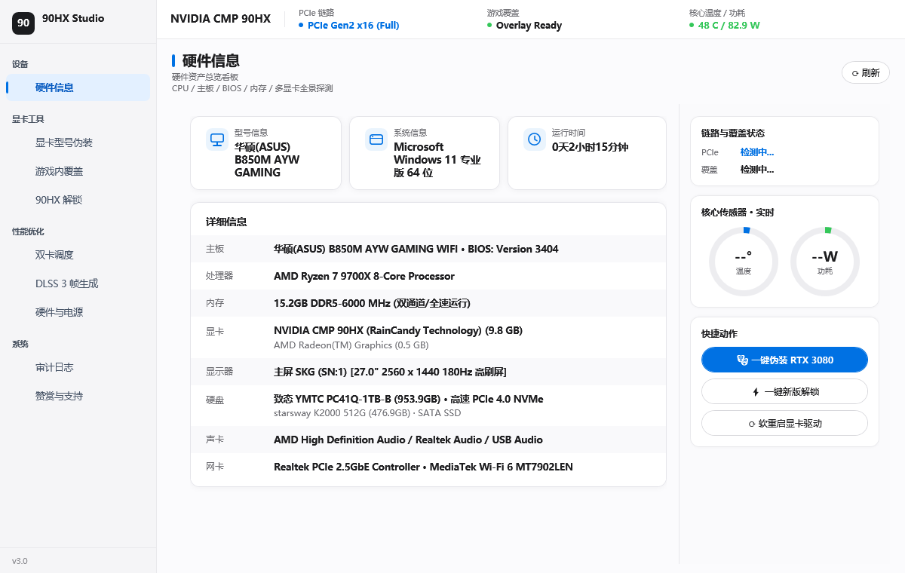

# HX家族多功能工具箱 (v5.0)

NVIDIA CMP 全系显卡（30HX / 40HX / 50HX / 70HX / 90HX / 170HX）综合硬件解锁、型号伪装、游戏覆盖补丁、DLSS 运行库与系统级自适应省电套件。单文件免安装，纯原生 Windows 桌面程序。



## v5.0 更新说明

本次大版本重点重构了电源管理、底层引导、多卡热重载与驱动伪装机制，修复了此前版本在各种环境下的若干核心问题：

### 1. 系统级动态省电重构
- **Session 0 隔离修复**：原计划任务使用 SYSTEM 账户在 Session 0 运行，导致 WDDM 驱动不暴露显示句柄，NVAPI 与利用率检测全部返回 -1，省电无法触发。现重构为当前用户登录交互会话（`TASK_LOGON_INTERACTIVE_TOKEN` + `TASK_RUNLEVEL_HIGHEST`），免 UAC 弹窗自启的同时保证正常读写显卡硬件状态。
- **全系卡型 PCI ID 补充**：底层句柄识别全面覆盖 30HX (`2189`)、70HX (`248A`, `24CA`)、170HX (`2082`, `20C2`, `2083`) 以及 90HX/50HX 衍生工程 ID。
- **显存锁频与时钟恢复链**：进入省电后，当检测到 GPU 负载（>3%）退出省电时，执行完整的 `-rac`（重置应用时钟）、`-rgc`（重置核心时钟）、`-rmc`（重置显存时钟）与功耗重置，修复了此前退出省电后显存依然停留在 405MHz 导致性能暴跌的 bug。
- **功耗墙自适应**：动态读取 vBIOS 的 `power.min_limit` 和 `power.default_limit`，避免下发低于硬件下限的数值被驱动拒绝。
- **后台守护进程长驻**：改用系统事件等待替代原有的 UI 消息循环，避免后台进程异常退出。

### 2. 多卡并发驱动热重载 (TASK-01)
- **串行化重载与复位缓冲**：多卡同时重载时加入 1200ms 的 PCIe 链路重训缓冲与 800ms 隔离间隔，避免内核驱动设备锁竞争。
- **状态就绪探针与自愈循环**：重载后自动通过 PnP 状态接口检查设备是否存在 Code 43 / Code 14 异常，若异常则自动执行禁用、放电等待与重新启用循环。
- **实例 ID 反查修复**：修正反查设备节点时的回退逻辑，避免多卡环境下错误指向同一设备。

### 3. 显卡伪装机制改进与安全回滚
- **彻底停止修改系统 INF 文件**：此前伪装时修改 `oemXX.inf` 导致其与 `.cat` 签名哈希不一致，驱动重载时被系统判定签名失效（40HX 等设备在管理器中直接消失）。现将伪装收敛至纯注册表与用户层缓存，保护驱动数字签名完整性。
- **自适应出厂名称还原**：恢复原名逻辑移除写死的 "RTX 3080" 和 "CMP 90HX"，根据实际卡型动态还原对应出厂标准名称，并彻底清除 `AdapterType`、`EnableMsHybrid` 等注入项。

### 4. NVIDIA App 覆盖解锁与双缓存清理 (TASK-03)
- **双缓存清理**：除主程序外，同步清理 `NVIDIA Overlay\CefCache` 独立渲染缓存，解决打补丁后 Alt+R / Alt+Z 无法呼出的问题。
- **弹性正则匹配**：补丁匹配逻辑支持等号翻转与松散空白，提升应对后续 NVIDIA App 前端更新的兼容性。
- **无 BOM 保存**：前端 JS 与 JSON 写入统一采用无 BOM UTF-8，防止严格解析器报语法错误。

### 5. DLSS 运行库探测与热替换 (TASK-04)
- **快速并发测速**：镜像检测超时从 8000ms 优化为 2500ms 并发探活，网络受阻时快速故障转移。
- **文件热重命名**：针对运行中的游戏目录，采用热重命名落盘，避免文件被占用时抛出 `IOException`。

---

## 支持型号

| 型号 | 架构 | 默认状态 | 建议伪装型号 | 特性 |
| :--- | :--- | :--- | :--- | :--- |
| **CMP 90HX** | GA102 | PCIe 1.1 / TCC模式 / 85W待机 | RTX 3080 10G / RTX 3090 | PCIe Gen2 x16 / 光追全开 / 25W待机 |
| **CMP 70HX** | GA104 | PCIe 1.1 / 驱动受限 | RTX 3070 / RTX 3070 Ti | 完整光追 / DLSS 3 帧生成 |
| **CMP 50HX** | TU102 | PCIe 1.1 / 无图形支持 | RTX 2080 Ti / RTX 2080 Super | Turing 光追单元激活 / 3D 渲染就绪 |
| **CMP 40HX** | TU106 | PCIe 1.1 / 签名冲突 | RTX 2060 Super | 纯注册表安全伪装 / Direct3D 3A 支持 |
| **CMP 30HX** | TU116 | PCIe 1.1 / 纯算力模式 | GTX 1660 Super | 1080P 网游高能效渲染 |
| **CMP 170HX** | GA100 | PCIe 4.0 / 算力节流 | NVIDIA A100 / RTX 6000 Ada | 大模型本地推理提速约 16 倍 |

---

## 核心功能

- **固件级解锁**：NVPermissiveEFI 方案，图形、算力与光追一并激活。支持现代 UEFI 直启（通道 A）、老主板 Shell 跨卷自适应链启（通道 B，配 3 秒独立 BCD 备份项）与 U 盘引导（通道 C/D）。
- **显卡型号伪装**：支持全系 76 款 GeForce 型号，注册表与应用缓存联动，PnP 原生热重载，无需重启电脑。
- **游戏覆盖解锁**：绕过 NVIDIA App 白名单，解锁 Alt+R 性能浮窗和 Alt+Z ShadowPlay 录屏。
- **DLSS 3 帧生成**：为 Ampere 架构激活 DLSS-G，内置多镜像测速与故障转移。
- **双卡 MS-Hybrid 调度**：核显输出 + 矿卡渲染，一键绑定高性能 GPU。
- **系统级动态省电**：空闲满 8 秒自动压入 P8 档位（待机功耗降低 60% 以上），有负载自动全速拉起。

---

## 使用说明

1. 下载最新可执行程序，双击运行（会自动请求管理员权限）。
2. 在「全系解锁」页面选择适合主板的引导通道，点击「执行新版解锁」。
3. 关机并断电 10 秒后重新开机，确认 PCIe 进入 Gen2 x16。
4. 在「显卡型号伪装」页面选择目标型号，点击执行伪装。
5. 首页点击「系统级省电」开启开机自启动态节能守护。
6. 所有修改均支持在界面上一键还原。

---

## 源码构建

纯原生 WPF + C# 5.0，系统内置编译器即可构建：

```powershell
powershell -ExecutionPolicy Bypass -File build_source\build.ps1
```

编译完成后在根目录生成 `HX家族多功能工具箱.exe` 与 `90HX Studio.exe`。

---

## 免责声明

非官方项目，与 NVIDIA 无关联。底层修改涉及驱动注册表、系统任务计划与引导配置，操作前请评估风险并备份重要数据。所有改动均可通过软件内置流程一键恢复官方设置。

---

RainCandy Technology 2026
