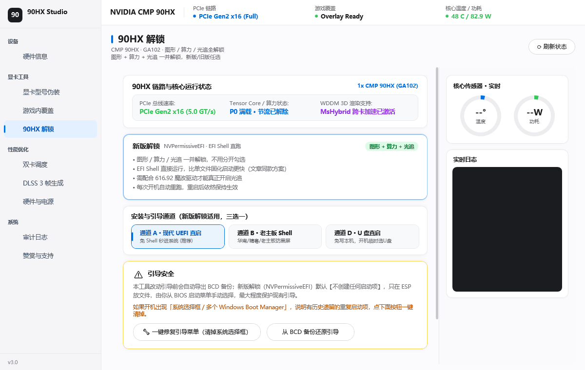

# HX 家族多功能工具箱

CMP 系列矿卡在 Windows 下的**工具合集**——解锁、伪装、省电、游戏覆盖、DLSS 帧生成、双卡调度、AI 诊断，一个 exe 全包。

这不是单一功能的解锁脚本，而是把折腾矿卡日常要用到的东西都收进同一个界面：该解锁的解锁，该省电的省电，出问题还能让 AI 帮你查。

单个 exe，免安装，双击就跑。全中文界面。

## 卡型支持一览

| 型号 | 识别 | 固件解锁 | 显卡伪装 | 动态省电 |
|---|---|---|---|---|
| CMP 90HX（GA102） | ✅ | ✅ | ✅ → RTX 3080 | ✅ |
| CMP 50HX（TU102） | ✅ | ✅ 专属页 | ✅ → RTX 2080 Ti | ✅ |
| CMP 40HX（TU106） | ✅ | ✅ 专属页 | ✅ → RTX 2060 SUPER | ✅ |
| CMP 70HX（GA104） | ✅ | ⏳ 待支持 | ✅ → RTX 3070 | ✅ |
| CMP 30HX（TU116） | ✅ | ⏳ 待支持 | ✅ → GTX 1660 SUPER | ✅ |
| CMP 170HX（GA100） | ✅ | ⏳ 待支持 | ✅ → A100-PCIE-40GB | ✅ |

**关于 170HX**：GA100 架构的固件路径和 GA102/TU102 完全不同，目前只做识别与伪装，**没有解锁页**。70HX / 30HX 同理——识别、伪装、省电都能用，解锁通道还在补。

伪装目标**按架构自动过滤**，跨架构的型号不会出现在下拉里——因为驱动认不到会直接掉设备。想恢复原名一键就能退回去。

## v5.0 更新说明

### 固件解锁

走 EFI Shell 直跑解锁固件，图形 / 算力 / 光追一并打开，同时把 PCIe 从 Gen1 x4 放开。部署独立启动项，不动 Windows 引导，失败有兜底。三种通道可选：现代 UEFI 直启、老主板 Shell、U 盘直启。

### 显卡伪装

把矿卡伪装成同架构的 GeForce。注册表、INF、NVIDIA App 缓存一起改，驱动热重载，不用重启电脑。

改 INF 前会自动备份原文件（`.bak`），恢复原名时自动还原——避免出现「改了之后设备消失」的情况。

### 动态省电

基于 NVAPI 直接把 P-State 上限压到 **P8**，比单纯锁频更彻底。

- 空闲 **8 秒**自动进入省电，检测到 GPU 负载 **立即恢复满血**
- 参数运行时动态查询：最低频率档位、默认功耗墙都读本卡真实值，不同卡型不会照抄
- 可注册为**开机自启的系统任务**（SYSTEM 权限），软件关了照样工作
- 实测 CMP 90HX：待机从 81W 降到 **17W** 左右

### 游戏内覆盖

绕过 NVIDIA App 白名单，解锁 Alt+R 性能浮窗和 ShadowPlay 录屏。

### DLSS 5 帧生成

给 SM86 强制开 DLSS-G，支持 RE 引擎框架。内置多条镜像线路，更新运行库自动选最快的。

### 双卡调度

核显输出 + 矿卡渲染，一键给 3A 游戏绑定高性能卡。

### AI 硬件助手

接了大模型，不只是问答，能**直接干活**：

- 说「把卡伪装成 3080」，出执行卡片，点一下真执行
- 说「我这卡解锁没成功」，自动读显卡状态、驱动版本、设备错误码、PCIe 链路，告诉你卡在哪一步
- 支持多步指令：「解锁并伪装」会按顺序列两张卡片
- 执行过程每步日志都显示在卡片里

### 硬件信息实时读取

CPU、主板、BIOS、UEFI、Secure Boot、HAGS、内存、显卡、显示器、硬盘、音频、网络、运行时间——全部实时采集，不是写死的示例值。

## 系统要求

- Windows 10 / 11 x64
- .NET Framework 4.6 或更高
- **管理员权限**（清单要求提权，非提权启动会被系统拒绝）
- 固件解锁需要：纯 UEFI（关闭 CSM）、关闭 Secure Boot、开启 Above 4G Decoding

## 快速开始

1. 从 [Releases](https://github.com/1922708082/90HX-Studio/releases) 下载最新的 `HX家族多功能工具箱-vX.X.X.exe`
2. 右键 → 以管理员身份运行
3. 「硬件概览」确认已识别到你的卡
4. 「90HX 解锁」或对应卡型的解锁页 → 按提示执行
5. 需要改名就去「显卡伪装」，需要省电就点首页的「动态省电」

### 3. 显卡伪装机制改进与安全回滚
- **彻底停止修改系统 INF 文件**：此前伪装时修改 `oemXX.inf` 导致其与 `.cat` 签名哈希不一致，驱动重载时被系统判定签名失效（40HX 等设备在管理器中直接消失）。现将伪装收敛至纯注册表与用户层缓存，保护驱动数字签名完整性。
- **自适应出厂名称还原**：恢复原名逻辑移除写死的 "RTX 3080" 和 "CMP 90HX"，根据实际卡型动态还原对应出厂标准名称，并彻底清除 `AdapterType`、`EnableMsHybrid` 等注入项。

### 4. NVIDIA App 覆盖解锁与双缓存清理 (TASK-03)
- **双缓存清理**：除主程序外，同步清理 `NVIDIA Overlay\CefCache` 独立渲染缓存，解决打补丁后 Alt+R / Alt+Z 无法呼出的问题。
- **弹性正则匹配**：补丁匹配逻辑支持等号翻转与松散空白，提升应对后续 NVIDIA App 前端更新的兼容性。
- **无 BOM 保存**：前端 JS 与 JSON 写入统一采用无 BOM UTF-8，防止严格解析器报语法错误。

## 注意事项

- **解锁有风险**。改动引导相关的内容前请自行备份系统，工具内提供 BCD 自检修复但不保证覆盖所有情况
- **网游请谨慎**。固件解锁是硬件层改动，系统内无痕；但任何驱动层的第三方工具都可能被反作弊扫到
- **省电模式跑重负载前记得恢复**，否则会被功耗墙限制性能
- 跨架构伪装不要尝试，驱动会直接认不到设备

## 开源协议

本项目采用 **MIT License**，详见 [LICENSE](LICENSE)。

## 免责声明

本项目仅供学习研究与**自有设备**的维护使用。使用者需自行承担操作风险，作者不对因使用本工具造成的硬件损坏、数据丢失或保修失效负责。请勿将本工具用于绕过版权保护或其他违法用途。
