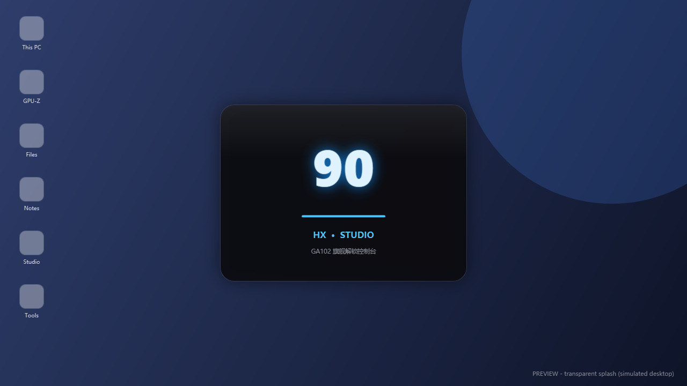

# 90HX Studio

CMP 90HX（GA102）的解锁与调优工具。图形、算力、光追一并解开，配套显卡伪装、游戏覆盖解锁、DLSS 3 帧生成和双卡调度。单文件免安装，双击就跑。


## 功能

- **解锁**：NVPermissiveEFI 方案，图形 / 算力 / 光追一起开。走 EFI Shell 直跑，部署独立启动项、不动 Windows 引导，失败自动兜底。三条引导通道可选：现代 UEFI 直启、老主板 Shell、U 盘直启。
- **显卡伪装**：把 90HX 伪装成 RTX 3080。注册表、INF 驱动文件、NVIDIA App 缓存一起改，驱动热重载，改完不重启电脑就生效。随时能恢复出厂原名。
- **游戏内覆盖**：绕过 NVIDIA App 白名单，解锁 Alt+R 性能浮窗和 ShadowPlay 录屏。
- **DLSS 3 帧生成**：给 SM86 强制开 DLSS-G，支持 RE 引擎框架。内置 4 条镜像线路，更新运行库自动选最快的。
- **双卡调度**：核显输出 + 90HX 渲染，一键给 3A 游戏绑定高性能卡。

界面是驾驶舱式的——传感器双环仪表、实时日志、快捷动作都在手边，执行解锁的时候不用切页面看日志。


启动动画：



## 下载

到 [Releases](../../releases/latest) 下 `90HX-Studio-v4.1.exe`，双击运行，不需要安装任何东西（会自己请求管理员权限）。

访问 GitHub 速度慢的话，挂个加速镜像即可。

## 使用

1. 打开软件，在「90HX 解锁」页选一条引导通道，点「执行新版解锁」
2. 完全关机再开机（注意是关机，不是重启），确认 PCIe 跑到了 Gen2 x16
3. 到「显卡型号伪装」页一键伪装成 RTX 3080
4. 进游戏按 Alt+R 看实时帧数和温度，Alt+Z 开录屏

所有操作都支持一键还原，改错了不怕。

## 从源码构建

纯 WPF + C# 5.0，不需要 Visual Studio，系统自带的编译器就够：

```
powershell -ExecutionPolicy Bypass -File build_source\build.ps1
```

完整构建需要 `assets.zip`（固件资源包）和 `build_source/mining_unlock_toolkit/`（解锁工具库），这两个因为体积和第三方版权原因没有放进仓库。没有它们也可以直接看 `build_source/src/` 里的源码。

## 免责声明

非官方项目，与 NVIDIA 无任何关联。解锁操作会修改驱动注册表和引导配置，请自行评估风险，操作前备份重要数据。所有改动都可以在软件内一键还原。

---

RainCandy Technology
